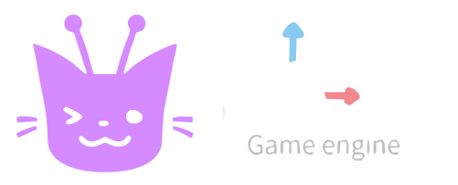

# Nodie Engine

  

---

**Nodie** é um fork da [Godot Engine](https://godotengine.org) (base: **4.7.2-stable**) com foco em
**usar a engine direto no celular**: interface refeita pensando em toque, telas pequenas e
orientação paisagem. O motor e a estrutura interna (nós, cenas, sinais, GDScript...) continuam
sendo os da Godot; o que muda é a forma de usar.

> Nodie = *node* + *indie*. As antenas do mascote são nós conectados.

> ⚠️ **Projeto experimental.** Hoje o Nodie é desenvolvido e testado principalmente no Android.
> Nada aqui é oficial, nem tem relação com a Godot Foundation (veja [Créditos](#créditos-e-licença)).

---

## O que é diferente da Godot

Tudo o que o Nodie muda está na **interface**. O núcleo da engine não foi alterado, e os
projetos continuam compatíveis com a Godot 4.7.

**Gerenciador de projetos**
- Barra de navegação lateral (Projetos, Biblioteca de Recursos, Configurações), pensada para paisagem.
- **Card do projeto recente**: o último projeto modificado aparece em destaque, em 16:9, com o
  **print do jogo**, o nome e a data da última modificação. Embaixo dele ficam o diretório, a
  versão, as tags e os botões de editar e de mais opções.
- Lista dos outros projetos em cards compactos, com **Editar** e **Executar** a um toque.
- Botão **Criar** flutuante e alvos de toque maiores (48dp ou mais).
- Cards arredondados, espaçamento maior e tema roxo como padrão.

**Print do jogo**
- Quando um jogo roda pelo Nodie, ele salva uma imagem pequena em
  `<projeto>/.godot/nodie_preview.png` ao fechar ou ir para o segundo plano.
- O arquivo é sempre sobrescrito, então os prints antigos somem sozinhos. A pasta `.godot`
  normalmente já fica fora do versionamento.
- Só existe em builds do editor. Jogos exportados (templates) não são afetados.

**App Android**
- Nome **Nodie Engine** e identificador próprio (`org.nodie.editor`), então o Nodie instala
  **ao lado** da Godot oficial, sem substituir nada.
- Ícone, ícone adaptativo e tela de abertura próprios.

## Ideias para o futuro

Nada disso está pronto:
- Uma **linguagem visual**, mantendo o GDScript como base.
- Um editor de imagens dentro da engine.
- Um criador de efeitos sonoros e músicas dentro da engine.

## Instalando (Android)

1. Abra a aba **Actions** do repositório e entre na execução mais recente do workflow.
2. Baixe o artefato do **Editor** (`android_editor-...`) e extraia o `.zip`.
3. Instale o `.apk` (o Android vai pedir para liberar a instalação de fontes desconhecidas).
4. No primeiro uso a lista de projetos começa vazia, então use **Escanear** para achar a sua pasta.

Observações:
- Os builds do CI saem assinados com uma chave de debug que muda a cada execução. Para instalar
  uma versão nova por cima de outra, talvez seja preciso **desinstalar a anterior** antes.
- O workflow atual compila o editor em **arm32** (`arch=arm32` em
  `.github/workflows/android_builds.yml`). Troque para `arm64` se o seu aparelho for de 64 bits.

## Compilando

O Nodie usa o mesmo sistema de build da Godot (SCons). As instruções oficiais valem, e o
repositório também compila na nuvem pelo **GitHub Actions** (só o job do Android está ativo):

- [Compilando a Godot (documentação oficial)](https://docs.godotengine.org/en/stable/contributing/development/compiling/index.html)

## Contribuindo

Issues e pull requests são bem-vindos. Contribuições seguem a mesma licença do projeto (MIT).
Se a ideia for uma mudança no núcleo da engine, considere propor primeiro no repositório
[upstream](https://github.com/godotengine/godot), que é o lugar certo para isso.

---

## Créditos e licença

**O Nodie existe graças à Godot Engine e às pessoas que a constroem.** Este repositório é um fork de
[godotengine/godot](https://github.com/godotengine/godot).

- **Godot Engine** © 2014-presente os contribuintes da Godot Engine.
  © 2007-2014 Juan Linietsky, Ariel Manzur.
- A lista de autores está em [`AUTHORS.md`](AUTHORS.md) e a de doadores em [`DONORS.md`](DONORS.md).
- As licenças da Godot e de todos os componentes de terceiros estão em
  [`LICENSE.txt`](LICENSE.txt), [`COPYRIGHT.txt`](COPYRIGHT.txt) e na pasta [`thirdparty/`](thirdparty).
  Esses arquivos foram **mantidos como estão** e precisam continuar acompanhando qualquer cópia do código.
- O README original da Godot foi preservado em [`README.godot.md`](README.godot.md).
- A janela **Sobre** do editor continua listando autores, doadores e licenças.

A Godot e este fork são distribuídos sob a **licença MIT**. As modificações do Nodie seguem a
mesma licença.

O mascote e o logo do Nodie foram criados por **CartolaDev**.

### Aviso de marca

O Nodie **não é afiliado, patrocinado nem endorsado** pela Godot Engine ou pela Godot Foundation.
"Godot" e o logo da Godot pertencem aos seus respectivos titulares e **não são** do Nodie. Eles são
citados aqui apenas para indicar de onde o projeto vem. Consulte as páginas oficiais em
[godotengine.org](https://godotengine.org) para a política de uso do nome e do logo.

---

## English summary

**Nodie** is a fork of [Godot Engine](https://godotengine.org) (based on **4.7.2-stable**) focused on
**using the editor directly on a phone**: a touch-friendly, landscape-first UI. The engine core is
unchanged, and projects stay compatible with Godot 4.7.

Highlights: a navigation rail, a 16:9 "recent project" card with an in-game preview, one-tap
Edit/Run on project cards, a floating Create button, a purple default theme, and an Android app that
installs side by side with official Godot (`org.nodie.editor`).

Install the Android editor from the **Actions** artifacts. Build instructions are the same as Godot's.

**Credits:** Nodie is built on Godot Engine, © 2014-present Godot Engine contributors and
© 2007-2014 Juan Linietsky, Ariel Manzur, under the MIT license. See `AUTHORS.md`, `DONORS.md`,
`LICENSE.txt` and `COPYRIGHT.txt`, which are kept unchanged. Nodie is **not affiliated with or
endorsed by** the Godot Engine or the Godot Foundation, and "Godot" and its logo are not Nodie's.
